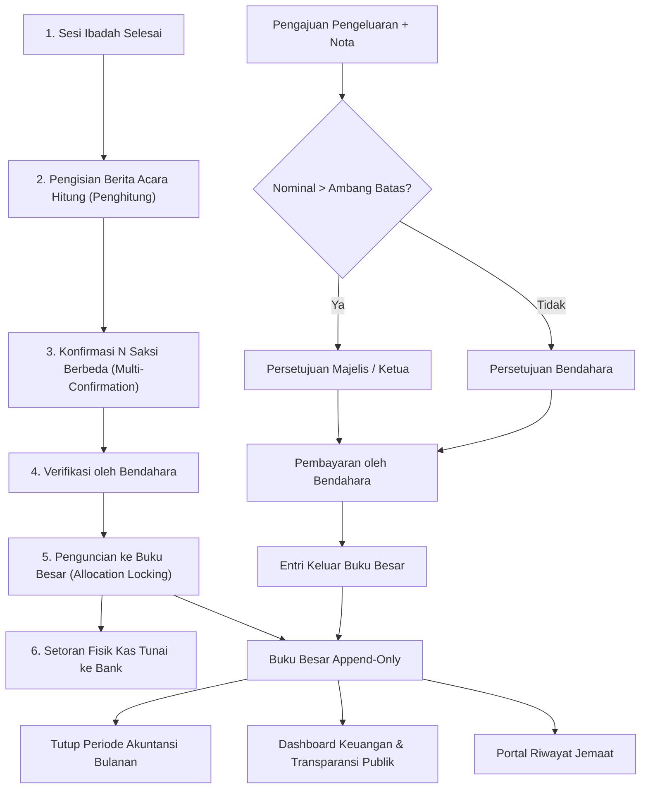

# Sistem Kas & Persembahan Gereja

Sistem informasi pengelolaan kas, persembahan, dan akuntabilitas keuangan gereja berbasis web modern. Dirancang dengan prinsip **ketertiban administrasi**, **buku besar append-only (kekekalan catatan)**, **pemisahan wewenang saksi (segregation of duties)**, serta **transparansi publik yang menjaga privasi jemaat**.

---

## 1. Arsitektur & Teknologi

Aplikasi ini dibangun menggunakan arsitektur monolit modern dengan pemisahan lapisan frontend dan backend yang mulus melalui protokol Inertia.js:

- **Backend Framework**: [Laravel 12](https://laravel.com) (PHP 8.2+)
- **Lapisan Frontend**: [Inertia.js 2](https://inertiajs.com) + [React 19](https://react.dev) + [TypeScript](https://www.typescriptlang.org)
- **Desain UI / Desain Sistem**: [Tailwind CSS 4](https://tailwindcss.com) + [shadcn/ui](https://ui.shadcn.com) + [Lucide Icons](https://lucide.dev)
- **Basis Data**: [PostgreSQL 15+](https://www.postgresql.org)
  - Seluruh nominal uang disimpan dalam satuan **bigint rupiah** (mencegah galat floating-point).
  - Buku besar transaksi (`ledger_entries`) berstatus **append-only** (tidak dapat diubah atau dihapus).
  - Skema Entity-Attribute-Value (EAV) bertipe data dinamis (`attribute_definitions` & `attribute_values`) untuk kustomisasi isian persembahan dan acara.
- **Pengujian Otomatis**: [Pest PHP](https://pestphp.com) untuk Unit, Feature, & Invariant Tests; TypeScript type checking (`tsc --noEmit`).

---

## 2. Persyaratan & Instalasi

### Persyaratan Sistem
- PHP >= 8.2 (ekstensi: `pdo_pgsql`, `mbstring`, `intl`, `bcmath`)
- Composer >= 2.6
- Node.js >= 20.x & npm
- PostgreSQL Server >= 15

### Langkah Instalasi

1. **Clone repositori dan pasang dependensi:**
   ```bash
   git clone <repository-url>
   cd SistemKasGereja
   composer install
   npm install
   ```

2. **Konfigurasi Environment (`.env`):**
   Salin file konfigurasi contoh:
   ```bash
   cp .env.example .env
   php artisan key:generate
   ```

   Sesuaikan koneksi PostgreSQL pada `.env`:
   ```env
   DB_CONNECTION=pgsql
   DB_HOST=127.0.0.1
   DB_PORT=5432
   DB_DATABASE=kas_gereja
   DB_USERNAME=postgres
   DB_PASSWORD=postgres

   APP_LOCALE=id
   APP_TIMEZONE=Asia/Jakarta
   ```

3. **Inisialisasi Basis Data & Data Awal (Seeder):**
   Buat basis data di PostgreSQL:
   ```bash
   createdb kas_gereja
   createdb kas_gereja_test
   ```

   Jalankan migrasi dan seeder peran serta akun awal:
   ```bash
   php artisan migrate --seed
   ```

4. **Jalankan Aplikasi:**
   ```bash
   npm start
   ```
   Perintah ini membangun aset lalu menjalankan server di `http://127.0.0.1:8000`. Untuk menjalankan tanpa membangun ulang aset, pakai `npm run serve`.
   Untuk pengembangan dengan Vite HMR, pakai `composer run dev`.

---

## 3. Matriks Peran & Hak Akses (7 Peran)

Sistem menerapkan kontrol akses berbasis peran (RBAC) menggunakan `spatie/laravel-permission` yang disesuaikan dengan struktur pelayanan gereja:

| Peran | Akses Utama | Tanggung Jawab & Kewenangan |
|---|---|---|
| **Admin** | Seluruh Sistem | Pengaturan gereja, master rekening & pos dana, manajemen pengguna, penugasan peran, dan konfigurasi aturan alokasi. |
| **Bendahara** | Keuangan & Pembukuan | Verifikasi berita acara hitung, penguncian ke buku besar, pencatatan setoran bank, eksekusi pembayaran pengeluaran, persetujuan pengeluaran di bawah ambang batas, dan laporan keuangan. |
| **Penghitung** | Penghitungan Kolekte | Mengisi formulir penghitungan fisik per pecahan uang, menandatangani konfirmasi berita acara sesi ibadah yang ditugaskan, dan mencatat persembahan atas nama. |
| **Majelis / Ketua** | Otorisasi & Pengawasan | Otorisasi dan persetujuan pengeluaran bernominal besar (di atas ambang batas `expense_approval_threshold`), serta memantau dasbor dan laporan pertanggungjawaban. |
| **Panitia Acara** | Kepanitiaan Acara | Mengelola pemasukan, penghitungan kolekte khusus acara, dan pengajuan biaya operasional yang dibatasi hanya pada acara yang ditugaskan padanya. |
| **Pemeriksa** | Audit & Pengawasan | Akses baca (*read-only*) ke seluruh transaksi, buku besar, dan jejak audit (*audit trail*) tanpa hak manipulasi data. |
| **Jemaat** | Portal Pribadi | Melihat riwayat persembahan atas nama sendiri, mengunduh bukti kwitansi tunggal, dan mencetak surat keterangan kontribusi tahunan. |

---

## 4. Alur Kerja Keuangan Utama (Financial Workflow)



### 1. Sesi Ibadah & Berita Acara Hitung (Count Sheet)
- Penghitungan uang kolekte dilakukan segera setelah ibadah selesai.
- Antarmuka ramah perangkat bergerak (*mobile-friendly*): input jumlah lembar/keping per pecahan uang rupiah (`100.000`, `50.000`, `20.000`, dst.).
- Subtotal dihitung langsung di layar jemaat, tetapi **selalu divalidasi dan dihitung ulang di server** untuk menjamin akurasi.
- Pencatatan persembahan khusus beramplop atau atas nama jemaat terikat langsung ke berita acara bersangkutan.

### 2. Konfirmasi Multi-Penghitung (Multi-Confirmation)
- Mencegah kecurangan perorangan: berita acara wajib dikonfirmasi minimal oleh $N$ orang saksi penghitung yang berbeda (dikonfigurasi pada `ChurchSetting.min_confirmations_service`).
- Pengeditan rincian hitungan secara otomatis membatalkan seluruh konfirmasi sebelumnya untuk mencegah perubahan sepihak.

### 3. Verifikasi Bendahara & Setoran Bank
- Setelah kuorum konfirmasi terpenuhi, status berita acara berpindah ke `confirmed`.
- Bendahara memeriksa kebenaran fisik uang dan memvalidasi ke status `verified`.
- Dana kas fisik dapat dipindahkan ke rekening bank gereja melalui fitur **Setoran Bank** yang mencatat mutasi antar-rekening di buku besar.

### 4. Penguncian Alokasi ke Buku Besar (Allocation Locking)
- Berita acara yang terverifikasi dikunci ke buku besar (`locked`).
- Dana penerimaan dibagi ke pos-pos dana (misal: Dana Kas Umum, Dana Diakonia, Dana Pembangunan) berdasarkan **Aturan Alokasi Berversi** aktif (`allocation_rules`).
- Pembagian persentase harus berjumlah tepat 100%, dengan sisa pembulatan rupiah otomatis dialokasikan ke pos dana pertama.
- **Koreksi Transaksi**: Data terkunci tidak dapat dihapus atau diedit; koreksi wajib dilakukan melalui **entri pembalik** (*reversal entry*) yang mencatat alasan pembatalan.

### 5. Pengajuan & Persetujuan Pengeluaran Bertingkat
- Setiap pengajuan biaya kas operasional wajib melampirkan foto bukti nota fisik (`proof_path`).
- **Anti Self-Approval**: Pengaju tidak diizinkan menyetujui pengajuannya sendiri.
- **Otorisasi Berjenjang**:
  - Nominal $\le$ ambang batas: dapat disetujui oleh Bendahara.
  - Nominal $>$ ambang batas (`ChurchSetting.expense_approval_threshold`): wajib disetujui oleh Majelis / Ketua.
- Saldo pos dana dicek secara ketat; penarikan yang menyebabkan saldo negatif otomatis ditolak kecuali gereja mengaktifkan `allow_negative_balance`.
- Setelah disetujui, pembayaran dicatat sebagai entri keluar (`direction = 'out'`) di buku besar.

### 6. Penutupan Periode Akuntansi (Period Close)
- Pada akhir bulan kalender, admin/bendahara dapat menutup periode akuntansi.
- Transaksi baru atau pengajuan dengan tanggal transaksi di periode tertutup **secara tegas ditolak** oleh sistem.

### 7. Halaman Transparansi Publik & Portal Jemaat
- **Transparansi Publik (`/transparansi`)**:
  - Dapat diakses tanpa login (publik), dengan tombol aktif/nonaktif melalui pengaturan gereja.
  - Menerapkan **privasi tanpa kompromi**: hanya menampilkan angka agregat per kategori kas publik (`is_public = true`) dan total saldo pos dana.
  - **Sama sekali tidak menampilkan** nama donatur, nomor identitas, toko/rekanan vendor, atau nominal per transaksi perorangan.
- **Portal Jemaat (`/portal`)**:
  - Area khusus jemaat terdaftar untuk melihat seluruh riwayat persembahan atas namanya sendiri.
  - Proteksi **IDOR (Insecure Direct Object Reference)** ketat: jemaat tidak dapat melihat, memodifikasi, atau mencetak bukti milik jemaat lain.
  - Fitur cetak kwitansi tunggal dan Surat Keterangan Kontribusi Tahunan resmi untuk keperluan arsip keluarga maupun bukti perpajakan.

---

## 5. Pengujian & Jaminan Mutu

Seluruh modul dan invarian sistem diuji secara ketat melalui rangkaian pengujian otomatis:

```bash
# Menjalankan seluruh test suite Pest
php artisan test

# Menjalankan pengujian spesifik invarian sistem
php artisan test --filter=SystemInvariantsTest

# Memeriksa integritas tipe TypeScript
npm run typecheck # atau: ./node_modules/.bin/tsc --noEmit
```

### Invarian Kritis yang Dijamin:
1. **Append-Only Ledger**: Pemanggilan `update()` atau `delete()` pada model `LedgerEntry` selalu melempar `LogicException`.
2. **Data Privacy Zero-Leak**: Tidak ada kebocoran string nama pribadi, no. telepon, email, atau catatan personal pada respons publik `/transparansi`.
3. **IDOR Immunity**: Percobaan membuka rute `/portal/receipt/{id}` atau laporan tahunan milik jemaat lain selalu menghasilkan respons `403 Forbidden`.
4. **Keseimbangan Matematis**: Jumlah netto seluruh mutasi buku besar selalu sama persis dengan total penjumlahan saldo seluruh pos dana dan rekening kas.
